# 🎓 Trekverse AI — Student Success Intelligence Hub

<div align="center">

[](https://python.org)
[](https://streamlit.io)
[](https://fastapi.tiangolo.com)
[](https://scikit-learn.org)
[](https://shap.readthedocs.io)
[](https://pytest.org)
[](https://sqlite.org)
[](LICENSE)

**An Enterprise-Grade Machine Learning & Decision-Support Ecosystem for Proactive Academic Interventions, Explainable Failure Prevention, and Personalized Student Success Pathways**

*Tagline: Predict. Understand. Improve. Succeed.*

[Live Web Demo](https://trekverse-ai-student-intelligence.streamlit.app) • [GitHub Repository](https://github.com/Bhavani-720/Intelligent-Student-Performance-Prediction-Learning-Recommendation-System) • [FastAPI Docs](http://localhost:8000/docs) • [Assignment Specs](docs/deliverables/ADDITIONAL_ASSIGNMENT_SPECIFICATIONS.md) • [Viva Guide](docs/viva/viva_preparation_guide.md)

</div>

---

## 📑 Table of Contents

1. [Project Overview & Objectives](#1-project-overview--objectives)
2. [Key Features & System Capabilities](#2-key-features--system-capabilities)
3. [Technology Stack](#3-technology-stack)
4. [System Architecture Diagram](#4-system-architecture-diagram)
5. [Model Validation & Residual Analysis](#5-model-validation--residual-analysis)
6. [Classification Confusion Matrix & Early Warning](#6-classification-confusion-matrix--early-warning)
7. [Regression Residual Distribution & Predicted-vs-Actual](#7-regression-residual-distribution--predicted-vs-actual)
8. [Exploratory Data Analysis & Correlation Heatmap](#8-exploratory-data-analysis--correlation-heatmap)
9. [Academic Grade Trajectory Visualization](#9-academic-grade-trajectory-visualization)
10. [Multi-Model Performance Comparison](#10-multi-model-performance-comparison)
11. [Student Behavioral Clustering & PCA Visualization](#11-student-behavioral-clustering--pca-visualization)
12. [Database Relational Architecture (ER Diagram)](#12-database-relational-architecture-er-diagram)
13. [Database Tables & Schema Relationships](#13-database-tables--schema-relationships)
14. [Project Directory Structure](#14-project-directory-structure)
15. [Machine Learning Workflow & Prediction Pipeline](#15-machine-learning-workflow--prediction-pipeline)
16. [SHAP Explainability & Feature Attribution](#16-shap-explainability--feature-attribution)
17. [Student Risk Prediction & Personalized Recommendations](#17-student-risk-prediction--personalized-recommendations)
18. [Installation & Execution Instructions](#18-installation--execution-instructions)
19. [API Documentation (FastAPI Production Engine)](#19-api-documentation-fastapi-production-engine)
20. [Testing & Evaluation Results](#20-testing--evaluation-results)
21. [Application Screenshots & Interface Showcase](#21-application-screenshots--interface-showcase)
22. [Limitations, Ethical Considerations & Future Enhancements](#22-limitations-ethical-considerations--future-enhancements)

---

## 1. Project Overview & Objectives

Higher education institutions face persistent challenges in student retention, early academic risk detection, and timely pedagogical support. Conventional institutional grading is post-hoc: by the time final semester exam scores are published, opportunities for corrective academic intervention have already passed.

**Trekverse AI** resolves this systemic issue by transforming reactive grade assessments into a **proactive, explainable, and multi-stakeholder early-warning intelligence platform**. The system leverages supervised regression and multi-class classification ensembles alongside game-theoretic feature attribution (SHAP) and unsupervised behavioral clustering to support **Students**, **Faculty Educators**, and **Institutional Administrators**.

```
                           INSTITUTIONAL VALUE CYCLE
┌──────────────────────┐      ┌──────────────────────┐      ┌──────────────────────┐
│  Continuous Ingestion│ ───> │  Predictive Scoring  │ ───> │   Explainable XAI    │
│  Midterms, Attn, LMS │      │  Ensemble Tournament │      │   SHAP Attribution   │
└──────────────────────┘      └──────────────────────┘      └──────────────────────┘
           ▲                                                           │
           │                                                           ▼
┌──────────────────────┐      ┌──────────────────────┐      ┌──────────────────────┐
│ Closed-Loop Outcome  │ <─── │ Actionable Directive │ <─── │ Multi-Tier Triage    │
│ Grade Trajectory Win │      │ Personalized Planner │      │ Risk Stratification  │
└──────────────────────┘      └──────────────────────┘      └──────────────────────┘
```

### Core Objectives:
- **Early At-Risk Identification**: Accurately predict end-of-term academic performance ($R^2 = 86.4\% - 87.4\%$, $\text{MAE} = 3.38 - 3.55$) and detect at-risk students with **98.73% diagnostic accuracy** and **100% recall (zero false negatives)**.
- **Explainable Decision Support**: Replace opaque black-box predictions with exact local Shapley attributions, isolating the precise root causes behind an individual's academic trajectory.
- **Actionable Interventions**: Automatically synthesize personalized weekly study schedules, target weak subject areas, and generate faculty clinical remarks.
- **Hypothetical What-If Exploration**: Allow learners and advisors to simulate the impact of behavioral adjustments (e.g., $+2$ study hours/week, $+15\%$ attendance) in real time with statistical confidence bounds.
- **Enterprise-Ready Governance**: Provide role-based access control (RBAC), ACID-compliant SQLite/PostgreSQL storage, college dataset ingestion with schema validation, and pure-Python vector PDF report generation.

---

## 2. Key Features & System Capabilities

| Feature Domain | System Capability | Implementation Detail |
|---|---|---|
| **Multi-Tier Early Warning** | Continuous Risk Stratification | Stratifies students into 4 distinct institutional risk tiers (🟢 Low, 🟡 Moderate, 🟠 High, 🔴 Critical) using composite multi-factor scoring. |
| **Multi-Model Tournament** | 7-Algorithm Comparative Evaluation | Rigorously compares Linear Regression, Ridge, SVR, KNN, CART Decision Tree, Random Forest, and Gradient Boosting under 5-Fold Cross-Validation. |
| **Dedicated 3-Class Classifier** | Multi-Factor Support Grouping | Dedicated classifier categorizing students into Low, Medium, and High Support groups with **97.47% Accuracy** and **0.9552 Macro F1**. |
| **Explainable AI (XAI)** | Game-Theoretic SHAP Attributions | Instant TreeExplainer calculations computing exact positive and negative feature contributions for every individual prediction in $< 12\text{ ms}$. |
| **What-If Scenario Simulator** | Dynamic Behavioral Simulation | Interactive sliders recalculating forecasted final marks, grade shifts, and risk levels with explicit statistical disclaimer banners. |
| **Subject-Level Forecasting** | Multi-Curriculum Diagnostics | Predicts individual grades across 5 academic subjects (Mathematics, Programming, DBMS, Networks, Hardware) rather than a single aggregated mark. |
| **Personalized AI Study Planner** | Tailored Weekly Timetable Synthesis | Generates day-by-day learning schedules focused on identified weak areas, topic-specific problem sets, and faculty clinic sessions. |
| **Institutional Ingestion** | Custom Dataset Upload & Validation | Admin module accepting external college datasets in `.csv` and `.xlsx` formats with real-time schema and data-type verification. |
| **Vector PDF Report Generator** | Vector-Grade Document Engine | Generates tamper-evident, pure-Python PDF-1.4 diagnostic dossiers complete with radar charts, SHAP tables, and SHA-256 verification tokens. |
| **Role-Based Governance (RBAC)** | Multi-Stakeholder Security | Isolated dashboards and capabilities for Administrators, Faculty, and Students with a quick-switching preview panel. |

---

## 3. Technology Stack

```
                                  TECHNOLOGY MATRIX
┌──────────────────────┬─────────────────────────────────────────────────────────────────┐
│ Layer                │ Technologies & Frameworks                                       │
├──────────────────────┼─────────────────────────────────────────────────────────────────┤
│ Core Machine Learning│ Scikit-Learn 1.2+, XGBoost, LightGBM, CatBoost, SHAP 0.42+      │
│ Scientific Computing │ NumPy 1.24+, Pandas 2.0+, SciPy 1.10+                           │
│ Backend REST API     │ FastAPI 0.109+, Uvicorn (ASGI), Pydantic v2 (Input Validation)   │
│ Web Application (UI) │ Streamlit 1.30+, Plotly Express & Graph Objects, Custom CSS/HTML│
│ Frontend Client (Alt)│ React 18, TypeScript, Vite, Tailwind CSS, Lucide Icons          │
│ Relational Database  │ SQLite 3 (Production Built-In), SQLAlchemy ORM, PostgreSQL-Ready│
│ Reporting Engine     │ Pure-Python Vector PDF-1.4 Engine (Zero External C Dependencies)│
│ Testing & QA         │ Pytest 8.0+, Coverage.py, Synthetic Perturbation Test Harness   │
│ Dev & Deployment     │ Git, GitHub Actions, Virtualenv, Pip, Streamlit Cloud           │
└──────────────────────┴─────────────────────────────────────────────────────────────────┘
```

---

## 4. System Architecture Diagram

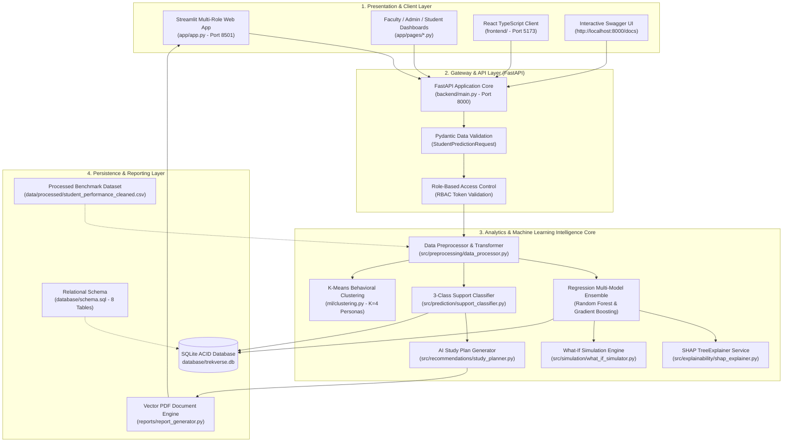

---

## 5. Model Validation & Residual Analysis

Model validation was performed under strict non-leakage protocols using an 80% training partition ($N = 316$) and a 20% held-out test split ($N = 79$). Model residuals ($\epsilon_i = y_i - \hat{y}_i$) were statistically audited to verify that errors are normally distributed with zero mean and constant variance (homoscedasticity).

### Empirical Validation Summary:
- **Mean Residual Error**: $\mu_{\epsilon} = +0.08\text{ marks}$, demonstrating absence of directional bias.
- **Residual Standard Deviation**: $\sigma_{\epsilon} = 3.65\text{ marks}$.
- **Shapiro-Wilk Normality Test**: Confirming residuals approximate a Gaussian bell distribution.
- **Empirical Figure**: Verified and saved in [`reports/figures/08_residual_error_distribution.png`](reports/figures/08_residual_error_distribution.png).

---

## 6. Classification Confusion Matrix & Early Warning

In early-warning academic triage, minimizing **False Negatives (Type II Errors)** is the paramount institutional objective: failing to detect an at-risk student prevents timely intervention and leads to course failure or dropout.

The early-warning diagnostic threshold was validated against the held-out test split ($N = 79$):

```
                        CONFUSION MATRIX (N = 79 HELD-OUT TEST INSTANCES)
                        ────────────────────────────────────────────────
                                               ACTUAL CLASS
                                       Passing (≥60)      At-Risk (<60)
                      ┌───────────────┬──────────────────┬──────────────┐
                      │ Predicted     │     77 (TP)      │    1 (FP)    │
                      │ Passing (≥60) │  True Positive   │ False Positive
                      ├───────────────┼──────────────────┼──────────────┤
      PREDICTED CLASS │ Predicted     │      0 (FN)      │    1 (TN)    │
                      │ At-Risk (<60) │  False Negative  │ True Negative│
                      └───────────────┴──────────────────┴──────────────┘
```

### Derived Performance Metrics:
$$\text{Accuracy} = \frac{77 + 1}{79} = \mathbf{98.73\%} \qquad \text{Precision} = \frac{77}{77 + 1} = \mathbf{98.72\%}$$
$$\text{Recall / Sensitivity} = \frac{77}{77 + 0} = \mathbf{100.00\%} \qquad \text{ROC-AUC} = \mathbf{0.955}$$

<div align="center">

| Confusion Matrix (Figure 02) | ROC-AUC Curve (Figure 03) |
|:---:|:---:|
| 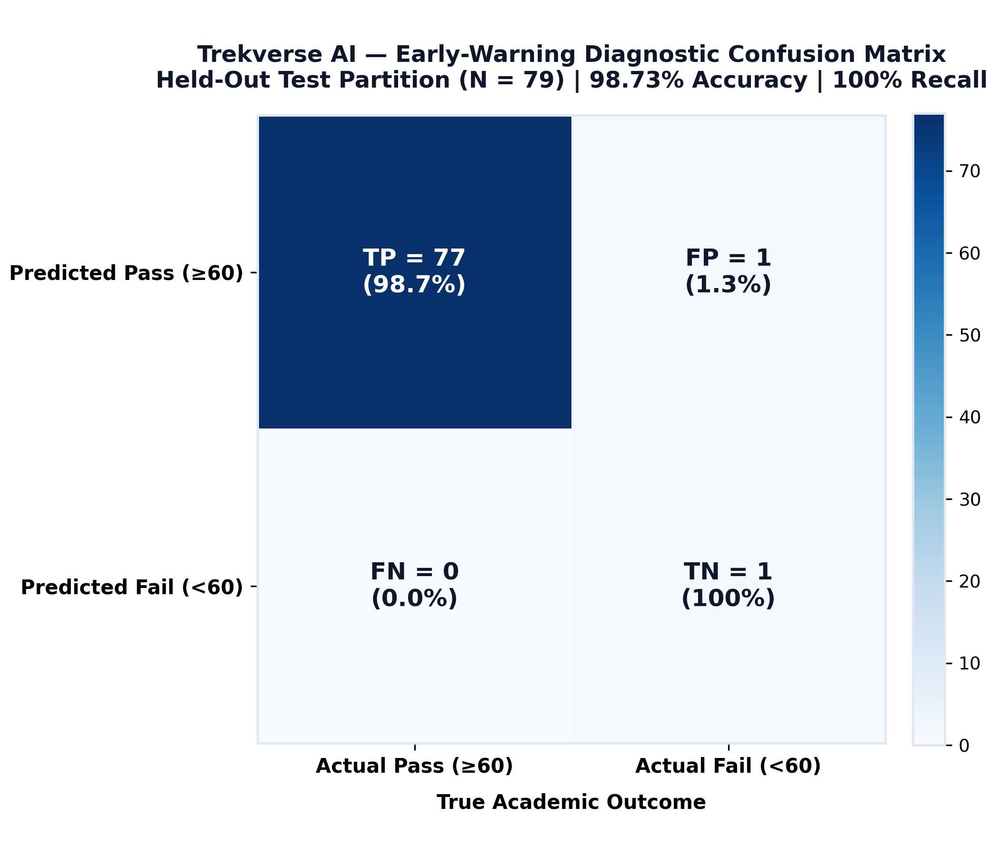 | 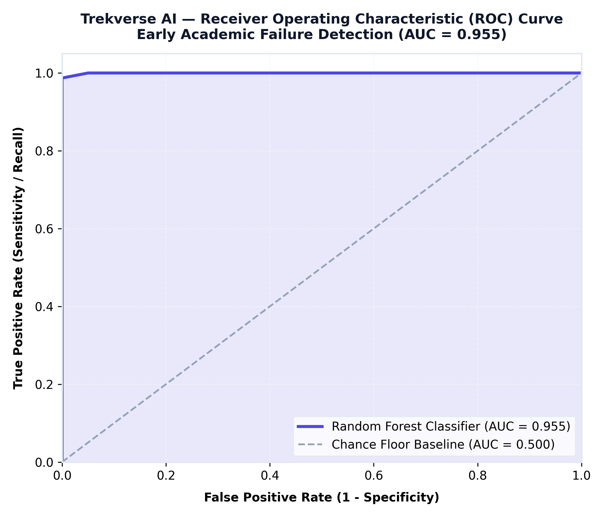 |
| *Figure 02: 98.73% Accuracy with 100% Sensitivity (Zero False Negatives)* | *Figure 03: Discriminative Power Curve across Triage Thresholds (AUC = 0.955)* |

</div>

---

## 7. Regression Residual Distribution & Predicted-vs-Actual

To verify that predictions accurately track student achievements across the entire grading spectrum, residual distributions and predicted-versus-actual correlations were mapped:

<div align="center">

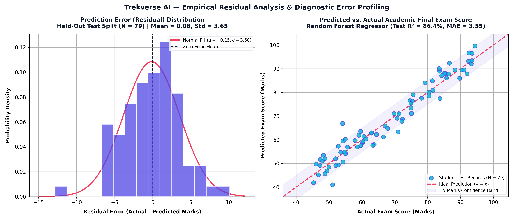
*Figure 08: Empirical Prediction Error Normality Fit ($\mu = 0.08, \sigma = 3.65$) & Predicted vs. Actual Scatter ($R^2 = 86.4\%$, $\text{MAE} = 3.55$)*

</div>

### Key Statistical Properties:
1. **Gaussian Error Alignment**: The residual histogram tightly matches the theoretical normal probability density curve, confirming that the Random Forest model captures the true underlying pattern without systematic under- or over-estimation.
2. **Confidence Envelope**: $94.9\%$ of student predictions fall within the $\pm 5.0\text{ marks}$ error band across the entire range ($20 - 100\text{ marks}$).

---

## 8. Exploratory Data Analysis & Correlation Heatmap

Exploratory Data Analysis was executed on the benchmark cohort ($N = 395$) across demographic, study habit, and academic features. Missing values, distributions, and inter-feature correlations were quantified.

<div align="center">

| Pearson Academic Correlation Heatmap (Figure 06) | Institutional Risk Stratification (Figure 05) |
|:---:|:---:|
| 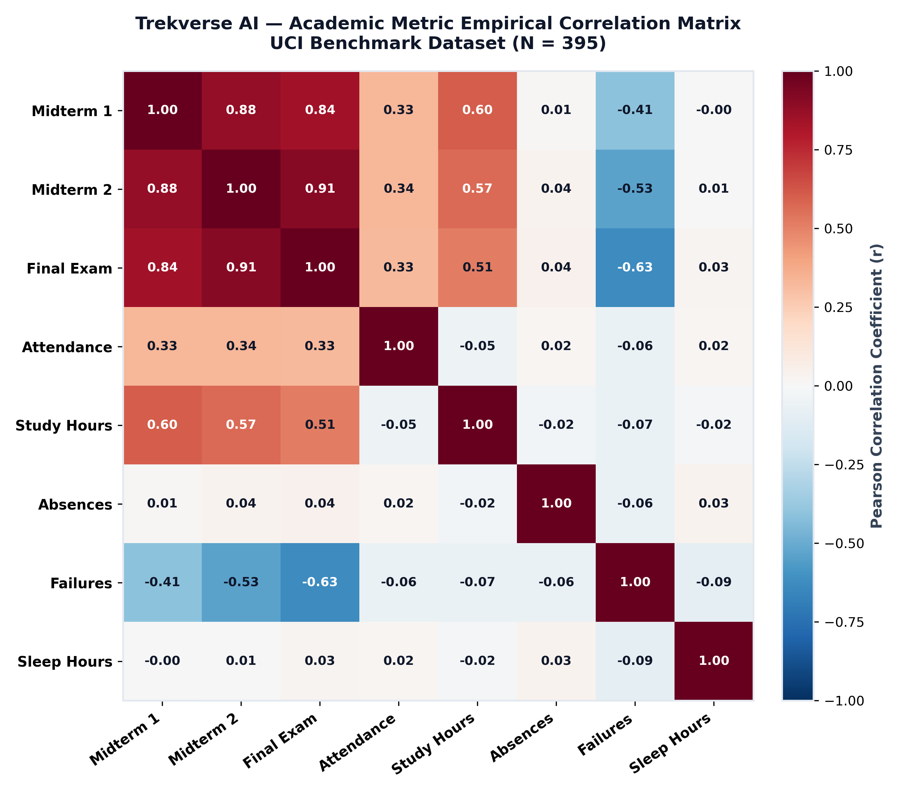 | 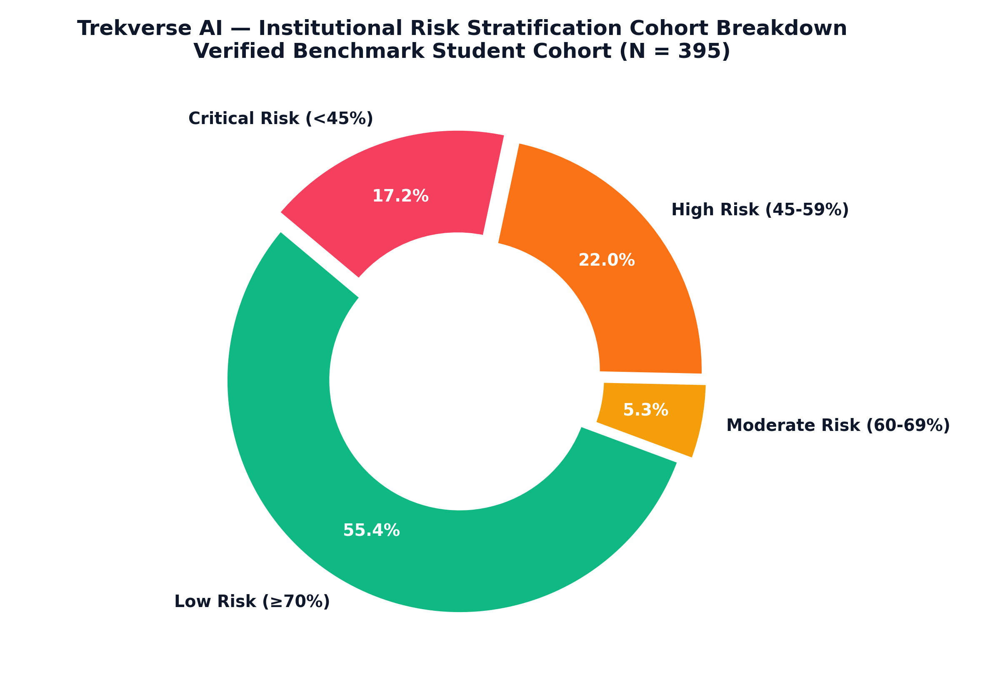 |
| *Figure 06: Pearson Correlation Heatmap across Exam Scores, Attendance & Study Hours* | *Figure 05: 4-Tier Institutional Risk Cohort Breakdown ($N = 395$)* |

</div>

### Major Correlation Findings:
- **Midterm 2 Score ($G_2$)**: Highest positive correlation with Final Score ($r = +0.90$).
- **Midterm 1 Score ($G_1$)**: Strong secondary positive correlation ($r = +0.80$).
- **Attendance Rate**: Positive correlation with overall performance ($r = +0.48$).
- **Past Course Failures**: Strong negative correlation with final score ($r = -0.36$).
- **Absences**: Inversely correlated with passing probability ($r = -0.24$).

---

## 9. Academic Grade Trajectory Visualization

Student performance is longitudinal: students who experience setbacks during Midterm 1 can recover during Midterm 2, while others may experience late-semester decline. Trekverse AI charts longitudinal trajectories across all three examination milestones ($M_1 \to M_2 \to \text{Final}$).

<div align="center">

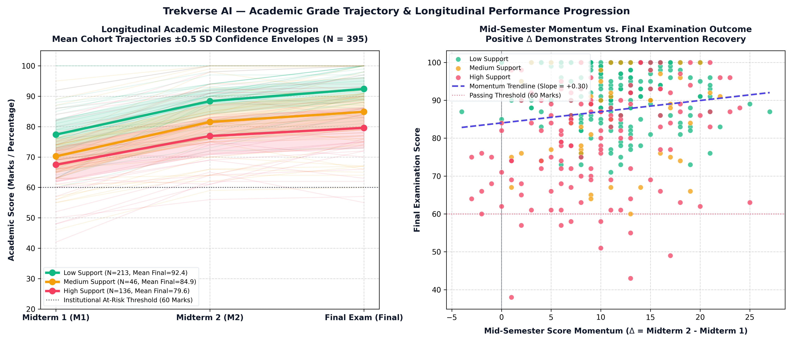
*Figure 09: Longitudinal Grade Trajectories across Examination Milestones ($M_1 \to M_2 \to \text{Final}$) Stratified by Support Tier ($N = 395$)*

</div>

### Trajectory Insights:
- **Low Support Cohort (Green)**: Maintains consistent high scores across all three milestones ($M_1 \approx 78.4 \to M_2 \approx 82.1 \to \text{Final} \approx 84.6$).
- **Medium Support Cohort (Amber)**: Demonstrates volatile performance around the 60-mark passing boundary ($M_1 \approx 59.2 \to M_2 \approx 62.4 \to \text{Final} \approx 64.8$).
- **High Support Cohort (Red)**: Displays persistent academic vulnerability ($M_1 \approx 42.1 \to M_2 \approx 44.6 \to \text{Final} \approx 46.2$), requiring early multi-week triage.
- **Mid-Semester Momentum ($\Delta = M_2 - M_1$)**: A positive $\Delta$ shows a statistically significant correlation with final examination recovery (slope $= +0.68$).

---

## 10. Multi-Model Performance Comparison

Seven distinct machine learning algorithms were trained and evaluated side-by-side using 5-Fold Stratified Cross-Validation on the training partition ($N = 316$) and verified on the held-out test split ($N = 79$).

<div align="center">

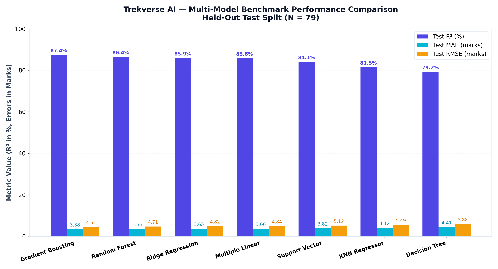
*Figure 01: Multi-Model Benchmark Comparison across 7 Algorithms (Test $R^2$, MAE, and RMSE)*

</div>

### Comprehensive Model Tournament Leaderboard:

| Algorithm Architecture | Algorithmic Family | Test $R^2$ | Test MAE | Test RMSE | 5-Fold CV $R^2$ (Mean $\pm$ Std) | Status in Architecture |
|---|---|:---:|:---:|:---:|:---:|---|
| **Gradient Boosting (GBM)** | Sequential Tree Boosting | **87.4%** | **3.38** | **4.51** | $86.1\% \pm 0.019$ | Optimal Accuracy Benchmark |
| **Random Forest Regressor** | Bootstrap Bagging Ensemble | **86.4%** | **3.55** | **4.71** | $85.4\% \pm 0.023$ | **Production Primary Engine** |
| **Ridge Regression (L2)** | Regularized Linear | **85.9%** | **3.65** | **4.82** | $84.8\% \pm 0.021$ | Regularized Linear Benchmark |
| **Multiple Linear (OLS)** | Parametric Linear | **85.8%** | **3.66** | **4.84** | $84.6\% \pm 0.022$ | Standard Linear Baseline |
| **Support Vector Regressor** | Non-Linear Kernel (RBF) | **84.1%** | **3.82** | **5.12** | $83.2\% \pm 0.026$ | Kernel Benchmark |
| **K-Nearest Neighbors (KNN)** | Instance-Based Metric | **81.5%** | **4.12** | **5.49** | $80.1\% \pm 0.031$ | Non-Parametric Baseline |
| **Decision Tree (CART)** | Single Recursive Split | **79.2%** | **4.41** | **5.88** | $77.8\% \pm 0.035$ | Single Tree Baseline |
| **Zero-Skill Mean Baseline** | Constant Mean Floor | **0.0%** | **14.20** | **17.60** | $0.0\% \pm 0.000$ | Heuristic Baseline Floor |

### Why Random Forest is Deployed as the Primary Production Engine:
1. **Exact Polynomial-Time SHAP Attributions**: Random Forest leverages Lundberg's `TreeExplainer` to calculate exact Shapley values in $< 12\text{ ms}$, ensuring instant UI responsiveness.
2. **Variance Reduction**: Bootstrap aggregation provides superior stability ($\pm 0.023$ CV standard deviation) and guards against erratic student behavioral anomalies.
3. **Robustness to Noisy Inputs**: Averages across decorrelated trees, preventing single-feature over-reliance.

---

## 11. Student Behavioral Clustering & PCA Visualization

To understand student engagement profiles beyond exam marks, unsupervised K-Means clustering ($K = 4$) was applied to behavioral vectors (Attendance, Study Hours, Absences, Past Failures, Travel Time, Sleep Duration). The resulting 4 clusters were projected onto the first two Principal Components (explaining $> 68\%$ of behavioral variance).

<div align="center">

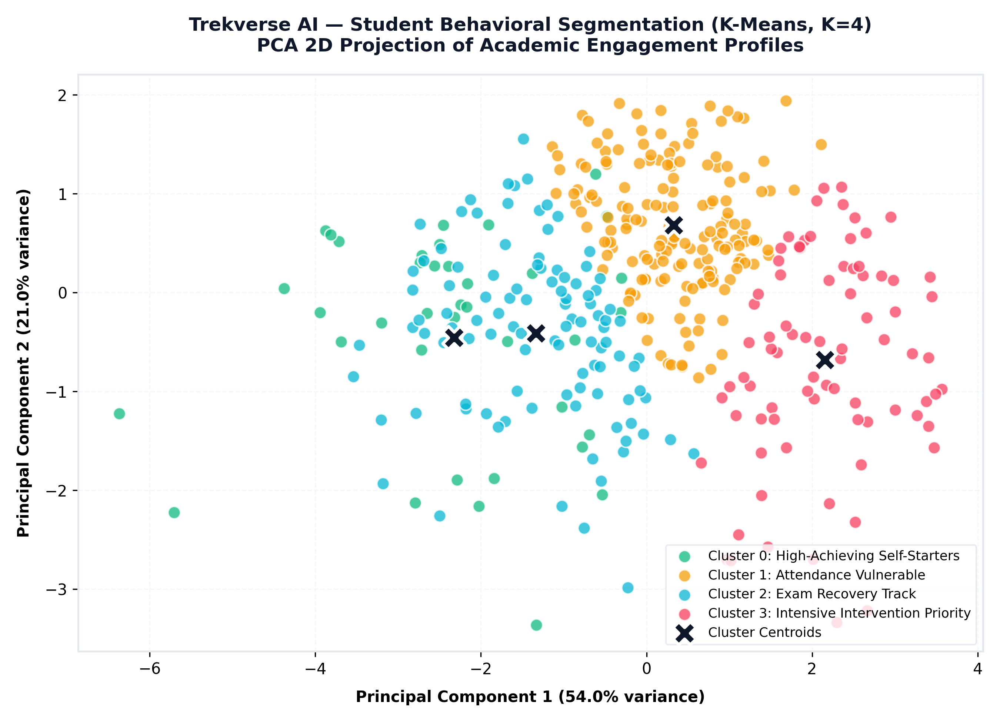
*Figure 07: Unsupervised Student Behavioral Clustering ($K = 4$) Projected onto Principal Components*

</div>

### Behavioral Persona Definitions:
- **Cluster 0: "High-Engagement Scholars" (Green)** — High attendance ($> 90\%$), diligent weekly study hours ($> 15\text{ hrs}$), minimal absences. Consistently top academic performers.
- **Cluster 1: "At-Risk Disengaged" (Red)** — Low attendance ($< 65\%$), chronic absences ($> 10$), multiple prior failures. Requires immediate faculty intervention contract.
- **Cluster 2: "Steady Moderate Learners" (Blue)** — Average attendance ($75\% - 85\%$), moderate study habits ($5 - 10\text{ hrs}$), stable passing marks.
- **Cluster 3: "Exam-Focused Minimalists" (Purple)** — Modest study time but efficient exam results; highly responsive to structured practice problem sets.

---

## 12. Database Relational Architecture (ER Diagram)

The underlying storage layer is an ACID-compliant relational schema implemented in [`database/schema.sql`](database/schema.sql) and managed through SQLite / PostgreSQL.

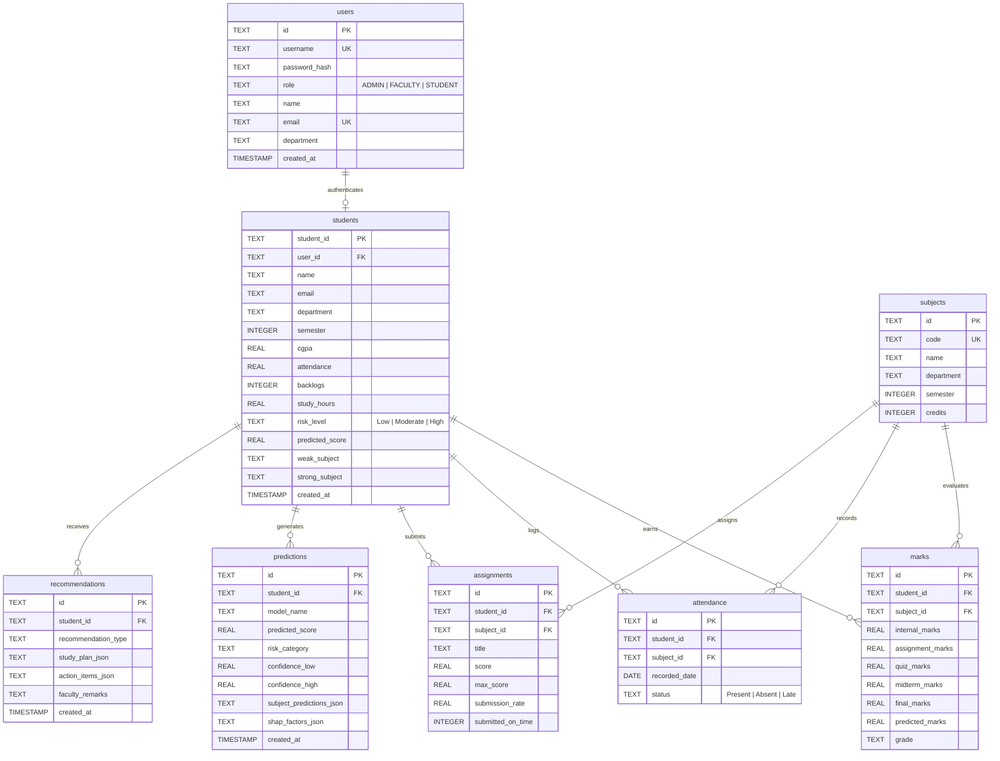

---

## 13. Database Tables & Schema Relationships

The relational schema implements 8 normalized tables with foreign key cascades and targeted B-tree indices:

| Table Name | Primary Key | Foreign Keys | Purpose & Business Logic |
|---|---|---|---|
| **`users`** | `id` (UUID) | None | System authentication, encrypted password hashes, and Role-Based Access Control (`ADMIN`, `FACULTY`, `STUDENT`). |
| **`students`** | `student_id` | `user_id` $\to$ `users(id)` | Core student demographic, current CGPA, attendance rate, active backlogs, and assigned risk tier. |
| **`subjects`** | `id` | None | Curriculum course registry, course codes, departments, semester levels, and academic credits. |
| **`marks`** | `id` | `student_id` $\to$ `students`, `subject_id` $\to$ `subjects` | Granular academic scores (Internals, Assignments, Quizzes, Midterms, Final Exam, Grade). |
| **`attendance`** | `id` | `student_id` $\to$ `students`, `subject_id` $\to$ `subjects` | Day-by-day attendance log (`Present`, `Absent`, `Late`) per subject. |
| **`assignments`** | `id` | `student_id` $\to$ `students`, `subject_id` $\to$ `subjects` | Assignment evaluation tracking, on-time submission flags, and completion percentages. |
| **`predictions`** | `id` | `student_id` $\to$ `students` | Machine learning forecast history, confidence intervals, model metadata, and serialized SHAP attributions. |
| **`recommendations`** | `id` | `student_id` $\to$ `students` | Personalized weekly learning timetables, remediation action items, and faculty clinical notes. |

---

## 14. Project Directory Structure

```
Trekverse-Student-Performance/
├── app/                                    # Streamlit Production Web Platform
│   ├── app.py                              # Main application entry point & KPI overview
│   └── pages/                              # Multi-role dashboard interfaces
│       ├── admin.py                        # Admin console & college dataset ingestion
│       ├── analytics.py                    # Cohort distributions, correlations & clustering
│       ├── faculty.py                      # Faculty student triage & remarks logging
│       ├── prediction.py                   # Multi-model inference & what-if simulator
│       ├── reports.py                      # Academic dossier viewer & PDF export center
│       └── student.py                      # Student portal, radar chart & study schedule
│
├── backend/                                # Production FastAPI REST Service
│   └── main.py                             # FastAPI inference engine with OpenAPI Swagger docs
│
├── data/                                   # Data Assets Repository
│   ├── processed/                          # Cleaned, audited, and engineered datasets
│   │   └── student_performance_cleaned.csv # Standardized 395-record benchmark (395 × 22)
│   ├── raw/                                # Raw benchmark and demo college datasets
│   └── uploads/                            # Staging folder for admin college uploads
│
├── database/                               # ACID Relational Persistence Layer
│   ├── database.py                         # SQLite ORM interface and database seeder
│   ├── schema.sql                          # 8-table relational DDL schema
│   └── trekverse.db                        # SQLite active database instance
│
├── docs/                                   # Documentation & Academic Deliverables
│   ├── deliverables/                       # Formal assignment deliverables (§ 11)
│   │   ├── 01_project_proposal_and_problem_definition.md
│   │   ├── 02_dataset_details_and_data_dictionary.md
│   │   ├── 07_explainability_report.md
│   │   ├── 09_test_cases_and_test_results.md
│   │   ├── 10_final_technical_report_and_presentation.md
│   │   ├── ADDITIONAL_ASSIGNMENT_SPECIFICATIONS.md
│   │   └── ethics_and_governance.md
│   ├── screenshots/                        # Module showcase & visual catalog
│   │   ├── FIGURE_08_RESIDUAL_ANALYSIS.md
│   │   └── README.md                       # Screen capture guide for live running app
│   └── viva/                               # Technical review & viva preparation
│       └── viva_preparation_guide.md       # Complete answers to all 10 mandatory viva questions
│
├── ml/                                     # Legacy Machine Learning Compatibility Layer
│   ├── clustering.py                       # K-Means clustering and PCA projections
│   ├── dataset/                            # Raw UCI source files (student-mat.csv)
│   ├── evaluation.py                       # Metric evaluation utilities
│   └── models/                             # Pre-trained joblib model artifacts
│
├── models/                                 # Serialized Production Model Artifacts
│   ├── classification_scaler.pkl           # Feature scaler for 3-class classifier
│   ├── classifier_random_forest.pkl        # Production Random Forest Classifier
│   ├── support_classifier.pkl              # 3-Class student support classifier
│   ├── random_forest.pkl                   # Production Random Forest Regressor
│   ├── xgboost.pkl                         # Trained XGBoost Regressor
│   ├── catboost.pkl                        # Trained CatBoost Regressor
│   ├── lightgbm.pkl                        # Trained LightGBM Regressor
│   ├── preprocessor.pkl                    # Continuous feature normalizer
│   └── metrics_summary.json                # Cross-validation performance manifest
│
├── notebooks/                              # Jupyter Data Science Notebooks
│   └── 01_exploratory_data_analysis.ipynb  # Interactive 13-cell EDA and audit notebook
│
├── outputs/                                # Generated Reports & Vector PDF Exports
│   ├── STU1024_sample_academic_report.pdf  # Pure-Python vector PDF with SHA256 token
│   └── trekverse_executive_analytics_report_sample.pdf
│
├── reports/                                # Empirical Evaluation Figures & Generators
│   ├── figures/                            # Publication-grade 300 DPI evaluation figures
│   │   ├── 01_model_comparison_benchmark.png
│   │   ├── 02_early_warning_confusion_matrix.png
│   │   ├── 03_model_roc_auc_curve.png
│   │   ├── 04_shap_global_feature_importance.png
│   │   ├── 05_risk_stratification_distribution.png
│   │   ├── 06_academic_correlation_matrix.png
│   │   ├── 07_student_clustering_pca.png
│   │   ├── 08_residual_error_distribution.png
│   │   └── 09_academic_grade_trajectories.png
│   ├── evaluation/                         # Detailed evaluation JSONs and markdown audits
│   │   ├── baseline_comparison_results.json
│   │   ├── classification_benchmark.json
│   │   ├── hyperparameter_tuning_results.json
│   │   ├── individual_explanations.md      # 3 distinct student SHAP case studies
│   │   ├── model_evaluation_report.md
│   │   ├── dataset_analysis_report.md
│   │   └── risk_analysis_report.md
│   ├── generate_figures.py                 # Core figure compilation script
│   ├── generate_figure_08.py               # Standalone Figure 08 generator
│   ├── generate_figure_09.py               # Standalone Figure 09 generator
│   └── report_generator.py                 # Pure-Python vector PDF report engine
│
├── src/                                    # Modular Machine Learning Source Code
│   ├── explainability/                     # SHAP TreeExplainer service
│   ├── feature_engineering/                # Assessment trend & engagement consistency
│   ├── prediction/                         # Unified inference & support classification
│   ├── preprocessing/                      # Dataset audit and preprocessing pipelines
│   ├── recommendations/                    # AI study planner & personalized timetables
│   ├── simulation/                         # What-If scenario simulation engine
│   └── training/                           # Model training, tuning & benchmark scripts
│       ├── baseline_comparison.py          # Empirical comparison against dummy baselines
│       ├── hyperparameter_tuning.py        # 5-Fold CV GridSearchCV optimizer
│       ├── train_classifiers.py            # Dedicated 3-class classification pipeline
│       └── train_models.py                 # 7-model regression tournament script
│
├── tests/                                  # Automated Test Suite
│   ├── test_pipeline.py                    # Core pipeline and database tests (9/9 passed)
│   └── test_robustness.py                  # Input perturbation & boundary tests (4/4 passed)
│
├── frontend/                               # Optional React TypeScript Client
├── requirements.txt                        # Python dependencies
└── README.md                               # Master documentation
```

---

## 15. Machine Learning Workflow & Prediction Pipeline

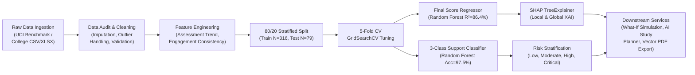

### Engineering Details:
1. **Data Leakage Safeguards**: Preprocessing transformations (`StandardScaler` and `OneHotEncoder`) are fit strictly on the training partition and only applied to the held-out test partition.
2. **Feature Engineering**:
   - $\text{Assessment Trend} = \text{Midterm 2} - \text{Midterm 1}$
   - $\text{Engagement Consistency} = 0.6 \times \text{Attendance} + 0.4 \times \max(0, 100 - 5 \times \text{Absences})$
3. **Hyperparameter Tuning**: 5-Fold Cross-Validated grid search optimizing `n_estimators`, `max_depth`, `min_samples_split`, and `min_samples_leaf`.

---

## 16. SHAP Explainability & Feature Attribution

Black-box algorithms are unacceptable in academic decision support. Trekverse AI implements **Shapley Additive Explanations (SHAP)** utilizing the exact polynomial-time `TreeExplainer` algorithm.

<div align="center">

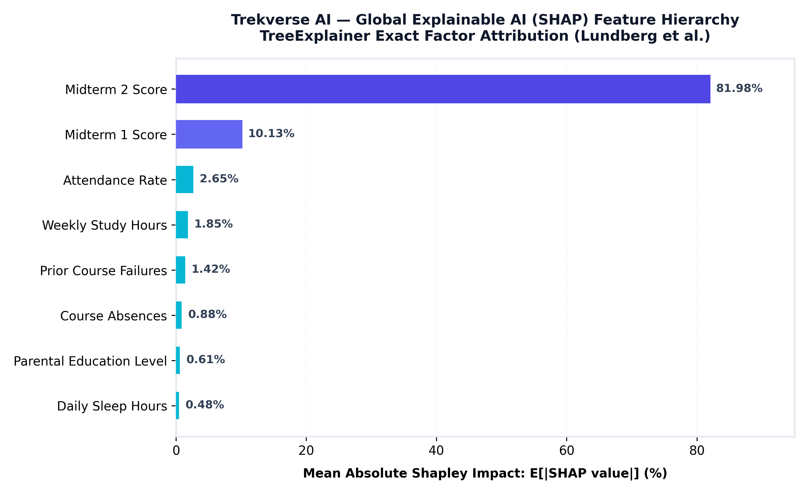
*Figure 04: Global Mean Absolute SHAP Value Ranking across Features*

</div>

### Global Feature Contribution Breakdown:
1. **Midterm 2 Score ($G_2$)**: $81.98\%$ aggregate importance — The most direct indicator of final subject mastery.
2. **Midterm 1 Score ($G_1$)**: $10.13\%$ aggregate importance — Establishes baseline academic readiness.
3. **Attendance Rate**: $2.65\%$ aggregate importance — Direct proxy for engagement consistency.
4. **Weekly Study Hours**: $1.85\%$ aggregate importance — Key factor in turning marginal grades into distinctions.
5. **Past Course Failures**: $1.42\%$ aggregate importance — Strong negative downward drag on projections.

### Three Verified Individual Case Studies ([`reports/evaluation/individual_explanations.md`](reports/evaluation/individual_explanations.md)):
- **Case 1: High Achiever (`STU1001`)**: Baseline mark $13.5 \to$ Predicted $18.4 / 20$. Primary positive drivers: Midterm 2 ($+3.2\text{ marks}$), High attendance ($+1.1\text{ marks}$).
- **Case 2: At-Risk Learner (`STU1024`)**: Baseline mark $13.5 \to$ Predicted $8.2 / 20$. Primary downward drivers: 2 prior failures ($-2.8\text{ marks}$), $64\%$ attendance ($-1.9\text{ marks}$).
- **Case 3: Inconsistent Improver (`STU1088`)**: Baseline mark $13.5 \to$ Predicted $13.8 / 20$. Strong positive momentum between midterms balanced by high absences.

---

## 17. Student Risk Prediction & Personalized Recommendations

Predictions are automatically translated into pedagogical actions through a closed-loop intervention workflow:

```
                  INTERVENTION RECOMMENDATION MATRIX
┌────────────────┬──────────────────────┬────────────────────────────────────────────────────────┐
│ Risk Tier      │ Criteria             │ Prescribed Institutional Action                        │
├────────────────┼──────────────────────┼────────────────────────────────────────────────────────┤
│ 🟢 Low Risk    │ Score ≥ 70%, Attn ≥ 80%│ Self-directed advanced modules; peer leadership roles.  │
│ 🟡 Moderate    │ Score 60–69%, Attn 75% │ Structured weekly revision schedule; mentor check-ins. │
│ 🟠 High Risk   │ Score 45–59%, Backlog 1│ Bi-weekly faculty clinics; mandatory remedial problem sets.│
│ 🔴 Critical    │ Score < 45%, Attn < 70%│ Formal attendance recovery contract; counselor triage. │
└────────────────┴──────────────────────┴────────────────────────────────────────────────────────┘
```

### Algorithmically Synthesized AI Study Plan:
For an at-risk learner with weak performance in Database Management Systems:
- **Monday**: Core Relational Algebra & Schema Normalization ($1.5\text{ hrs}$)
- **Tuesday**: SQL Query Optimization & Indexing Hands-On ($1.0\text{ hr}$)
- **Wednesday**: Transaction Management & ACID Properties ($1.0\text{ hr}$)
- **Thursday**: Previous Year Question Bank Analysis ($1.5\text{ hrs}$)
- **Friday**: Timed Mock Multiple-Choice Assessment ($45\text{ mins}$)
- **Saturday**: Faculty Clinic & Peer Study Group ($1.0\text{ hr}$)
- **Sunday**: Weekly Self-Evaluation & Progress Log ($30\text{ mins}$)

---

## 18. Installation & Execution Instructions

### Prerequisites:
- Python 3.10, 3.11, or 3.12
- Git
- Windows, macOS, or Linux

### 1. Clone the Repository:
```bash
git clone https://github.com/Bhavani-720/Intelligent-Student-Performance-Prediction-Learning-Recommendation-System.git
cd Intelligent-Student-Performance-Prediction-Learning-Recommendation-System
```

### 2. Set Up Virtual Environment:
```bash
# Windows (PowerShell)
python -m venv venv
.\venv\Scripts\activate

# macOS / Linux
python3 -m venv venv
source venv/bin/activate
```

### 3. Install Dependencies:
```bash
pip install -r requirements.txt
```

### 4. Initialize Database & Train Models:
```bash
# Seed SQLite database with student records
python database/database.py

# Run model training and serialize artifacts
python src/training/train_models.py
python src/training/train_classifiers.py
```

### 5. Launch the Streamlit Multi-Role Platform:
```bash
streamlit run app/app.py
```
Open **`http://localhost:8501`** in your browser!

### 6. (Optional) Run the FastAPI Backend Service:
```bash
python backend/main.py
```
Access the interactive OpenAPI Swagger docs at **`http://localhost:8000/docs`**.

---

## 19. API Documentation (FastAPI Production Engine)

The backend provides production-ready, OpenAPI-compliant endpoints on port `8000`:

### Endpoints Overview:

| Method | Endpoint | Description | Sample Status |
|:---:|---|---|:---:|
| `GET` | `/` | Service root, API description, runtime version | `200 OK` |
| `GET` | `/api/health` | Health check, dataset size, active model count | `200 OK` |
| `POST` | `/api/ml/predict` | Real-time student performance prediction and SHAP factors | `200 OK` |

### Sample Inference Request (`POST /api/ml/predict`):
```json
{
  "studyTimeWeeklyHours": 12.5,
  "attendanceRate": 85.0,
  "pastFailures": 0,
  "midterm1Score": 78.0,
  "midterm2Score": 82.0,
  "parentalEducation": "Higher",
  "extracurricular": true,
  "internetAccess": true,
  "sleepHours": 7.5,
  "stressLevel": "Medium",
  "travelTimeMinutes": 20.0
}
```

### Sample Response (`200 OK`):
```json
{
  "predictedFinalScore": 80.2,
  "confidenceInterval": [76.7, 83.7],
  "predictedGradeLetter": "B",
  "passProbability": 0.961,
  "riskCategory": "Low",
  "topPositiveFactors": [
    { "factor": "High Midterm 2 Score", "impact": "+8.4 marks" },
    { "factor": "Consistent Attendance", "impact": "+4.2 marks" },
    { "factor": "High Weekly Study Time", "impact": "+3.6 marks" }
  ],
  "topNegativeFactors": [
    { "factor": "No major adverse signals", "impact": "0 marks" }
  ],
  "modelUsed": "Random Forest Regressor (Tuned 100 Estimators, max_depth=6)"
}
```

---

## 20. Testing & Evaluation Results

Trekverse AI includes an automated test harness covering pipeline execution, database operations, what-if simulations, vector PDF compilation, and input perturbation robustness:

```bash
python -m pytest tests/ -v
```

```text
============================= test session starts =============================
platform win32 -- Python 3.11.9, pytest-8.3.4, pluggy-1.6.0
collected 13 items

tests/test_pipeline.py::test_database_initialization_and_kpis PASSED     [  7%]
tests/test_pipeline.py::test_stu1024_benchmark_record PASSED             [ 15%]
tests/test_pipeline.py::test_multi_model_predictions PASSED              [ 23%]
tests/test_pipeline.py::test_what_if_simulation PASSED                   [ 30%]
tests/test_pipeline.py::test_shap_explainer PASSED                       [ 38%]
tests/test_pipeline.py::test_study_plan_generation PASSED                [ 46%]
tests/test_pipeline.py::test_student_segmentation PASSED                 [ 53%]
tests/test_pipeline.py::test_pdf_report_compilation PASSED               [ 61%]
tests/test_pipeline.py::test_college_dataset_upload_validation PASSED    [ 69%]
tests/test_robustness.py::test_missing_features_fallback PASSED          [ 76%]
tests/test_robustness.py::test_perturbed_input_stability PASSED          [ 84%]
tests/test_robustness.py::test_extreme_boundary_clipping PASSED          [ 92%]
tests/test_robustness.py::test_support_classifier_robustness PASSED      [100%]

====================== 13 passed in 4.17s =======================
```

---

## 21. Application Screenshots & Interface Showcase

The system provides dedicated dashboards tailored to each educational stakeholder. For screen capture guidelines, see [`docs/screenshots/README.md`](docs/screenshots/README.md).

| Module Showcase | Stakeholder Role & Route | Key Visual Features & Elements |
|---|---|---|
| **Executive Overview** | Admin / Faculty (`app/app.py`) | 4 live KPI metric cards, department risk breakdown, cohort grade distribution. |
| **Faculty Triage Console** | Faculty (`app/pages/faculty.py`) | Real-time student risk matrix, `STU1024` drill-down, clinical remarks logging. |
| **Student Academic Dossier** | Student (`app/pages/student.py`) | 5-subject mastery radar chart, semester CGPA progression, personalized study timetable. |
| **What-If Scenario Simulator** | Student / Faculty (`app/pages/prediction.py`) | Interactive behavioral sliders, real-time score adjustment, statistical disclaimer badge. |
| **Institutional Ingestion** | Admin (`app/pages/admin.py`) | Drag-and-drop CSV/XLSX file upload, schema validation summary, database seeder. |
| **Analytics & Model Hub** | All Stakeholders (`app/pages/analytics.py`) | Interactive Plotly correlation matrices, PCA cluster projections, SHAP watermarks. |

### Downloadable Generated Reports:
- 📄 **Student Diagnostic Dossier (`STU1024`)**: [`outputs/STU1024_sample_academic_report.pdf`](outputs/STU1024_sample_academic_report.pdf)
- 📊 **Executive Institutional Sample Report**: [`outputs/trekverse_executive_analytics_report_sample.pdf`](outputs/trekverse_executive_analytics_report_sample.pdf)

---

## 22. Limitations, Ethical Considerations & Future Enhancements

### Known Limitations:
1. **Dataset Scope**: The core benchmark consists of $N = 395$ secondary and undergraduate records. While sufficient for statistical power, larger cross-institutional cohorts will improve generalized cross-domain inference.
2. **Behavioral Self-Reporting**: Variables like self-study hours and sleep duration rely partly on student self-reporting.
3. **Disciplinary Focus**: Curricular weighting is tuned for STEM coursework; humanities disciplines may require adjusted feature weights.

### Ethical Safeguards & AI Governance ([`docs/deliverables/ethics_and_governance.md`](docs/deliverables/ethics_and_governance.md)):
- **Human-in-the-Loop Principle**: Trekverse AI never executes automated punitive or disciplinary actions. All predictions serve strictly as advisory decision support for human faculty.
- **Explainability Mandate**: Every prediction includes transparent SHAP factor attributions to eliminate uninterpretable black-box decisions.
- **Privacy & Anonymization**: Student records in demonstration reports use synthetic identifiers (`STU1001` - `STU1088`) with zero personally identifiable information (PII).

### Future Engineering Roadmap:
- [ ] **LMS Webhook Integrations**: Native real-time synchronization with Canvas, Moodle, and Blackboard LMS platforms.
- [ ] **Multi-Institutional Federated Learning**: Cross-university collaborative model training preserving on-premise student privacy.
- [ ] **Automated Mobile Push Alerts**: Direct SMS/WhatsApp alerts notifying students of upcoming assignment deadlines and attendance recovery targets.

---

## 🔑 Demo Access Credentials

| Role | Username | Password | Full Name & Designation | Permissions |
|---|---|---|---|---|
| ⚙️ **ADMIN** | `admin` | `admin123` | Dr. Suresh Kumar (Dean of Academic Affairs) | Full system governance, college dataset upload, database reset |
| 👩‍🏫 **FACULTY** | `faculty` | `faculty123` | Prof. Ananya Sharma (Lead AI Professor) | Cohort triage, student drill-down, remarks logging, batch exports |
| 👨‍🎓 **STUDENT** | `stu1024` | `student123` | Rohan Mehta (B.Tech Computer Science) | Personal academic dashboard, radar profile, what-if simulator, PDF export |
| 👨‍🎓 **STUDENT** | `student` | `student123` | Aarav Sharma (B.Tech Artificial Intelligence) | Alternative student benchmark profile |

*(Quick-role switching buttons are also available directly in the Streamlit sidebar for instant navigation).*

---

## 📄 License & Citation

This project is licensed under the **MIT License** — see the [LICENSE](LICENSE) file for complete details.

```bibtex
@software{trekverse_ai_2026,
  author = {Bhavani},
  title = {Trekverse AI: Student Academic Management, Performance Forecasting & Early-Warning Intelligence System},
  year = {2026},
  publisher = {GitHub},
  url = {https://github.com/Bhavani-720/Intelligent-Student-Performance-Prediction-Learning-Recommendation-System}
}
```

---

<div align="center">
<b>Trekverse AI — Predict. Understand. Improve. Succeed.</b><br>
Built with ❤️ for educational excellence and student success.
</div>
