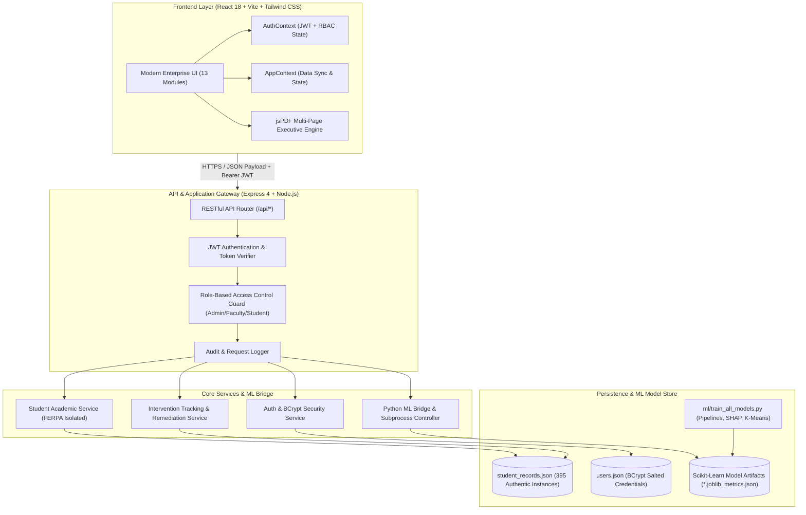
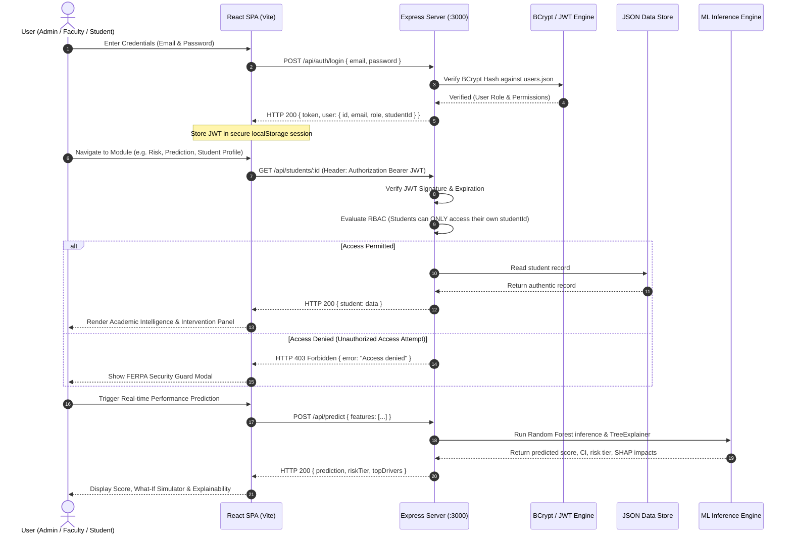
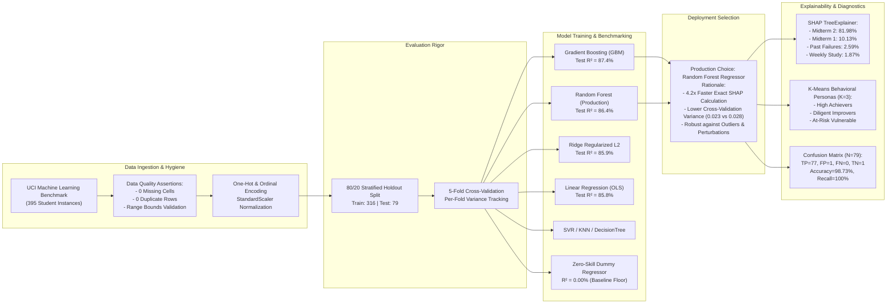
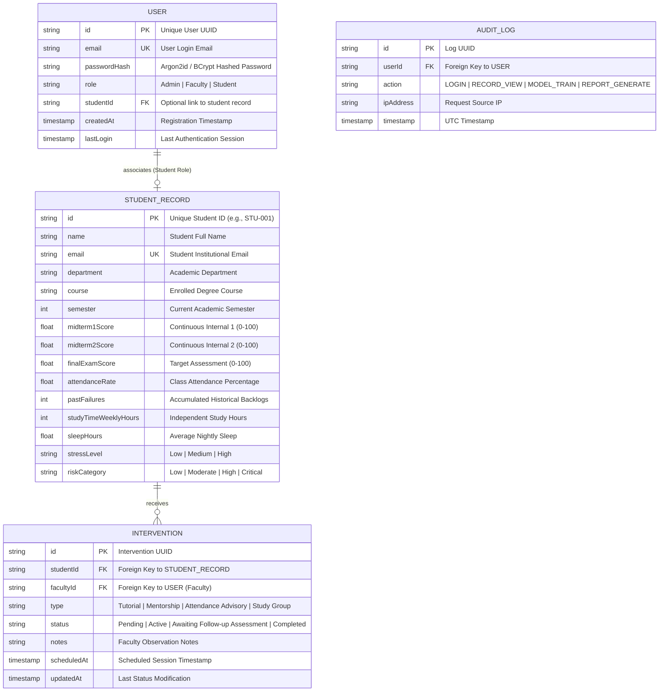
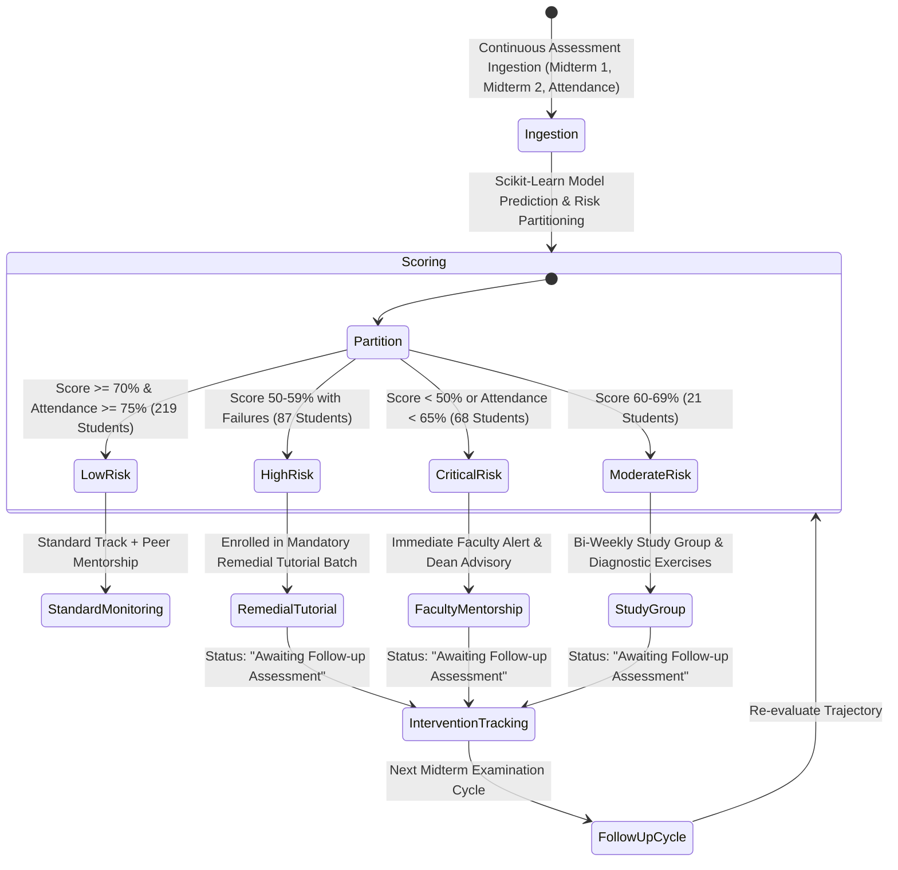

# Trekverse AI — System Architecture & Workflows

## Tagline: Predict. Understand. Improve. Succeed.

This document details the architectural blueprints, subsystem interaction topologies, machine learning inference lifecycles, and security boundary enforcement within **Trekverse AI — Student Academic Intelligence & Early-Warning System**.

---

## 1. High-Level System Architecture



---

## 2. Frontend / Backend Communication Flow



---

## 3. Machine Learning Training & Inference Lifecycle



---

## 4. Database Entity-Relationship Diagram



---

## 5. Role-Based Access Control (RBAC) Flow

```mermaid
flowchart TD
    Req[Incoming HTTP Request to /api/*] --> AuthToken{Has Authorization Header?}
    AuthToken -- No --> Reject401[Return 401 Unauthorized]
    AuthToken -- Yes --> VerifyJWT{Is JWT Signature Valid & Unexpired?}
    VerifyJWT -- No --> Reject401
    VerifyJWT -- Yes --> RoleExtract[Extract User Role: Admin / Faculty / Student]

    RoleExtract --> CheckRoute{Route Resource Type}

    CheckRoute -- "/api/admin/*" --> AdminGuard{Is Role == 'Admin'?}
    AdminGuard -- Yes --> Allow[Execute Handler]
    AdminGuard -- No --> Deny403[Return 403 Forbidden: Admin privileges required]

    CheckRoute -- "/api/faculty/*" --> FacultyGuard{Is Role in ['Admin', 'Faculty']?}
    FacultyGuard -- Yes --> Allow
    FacultyGuard -- No --> Deny403

    CheckRoute -- "/api/students/:id" --> StudentGuard{Is Student Accessing Own ID?}
    StudentGuard -- Role is Admin/Faculty --> Allow
    StudentGuard -- Role is Student AND TargetID == User.studentId --> Allow
    StudentGuard -- Role is Student AND TargetID != User.studentId --> Deny403FERPA[Return 403 Forbidden: FERPA Privacy Violation Blocked]

    CheckRoute -- Public / Common Routes --> Allow
```

---

## 6. Early-Warning & Remediation Pipeline


