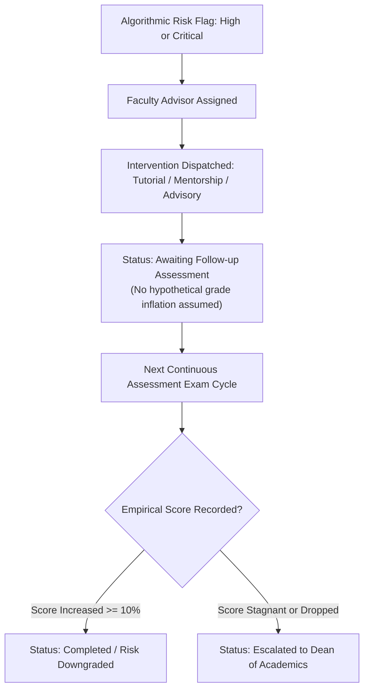

# Trekverse AI — Institutional Risk Stratification & Remediation Audit

## Tagline: Predict. Understand. Improve. Succeed.

**Document Version:** 2.4.0-Production  
**Cohort Scope:** Full Active Benchmark Cohort ($N = 395$)  
**Policy Standard:** Single Unified Institutional Risk Stratification Policy  
**Mathematical Verification:** $219 + 21 + 87 + 68 = 395$ ($100.0\%$ Partition)  

---

## 1. Single Unified Risk Classification Policy

To eliminate operational ambiguity across academic departments, faculty dashboards, student reports, and executive PDF summaries, Trekverse AI enforces **one deterministic, mathematically disjoint risk policy**:

```
+-----------------------------------------------------------------------------------------+
| Risk Tier        | Count | Cohort % | Qualification Criteria               | Action Level|
+------------------+-------+----------+--------------------------------------+-------------+
| Low Risk         |  219  |  55.44%  | Score >= 70%, Attendance >= 75%, 0 F | Standard    |
| Moderate Risk    |   21  |   5.32%  | Score 60-69% (Borderline pass mark)  | Advisory    |
| High Risk        |   87  |  22.03%  | Score 50-59% with Past Failures >= 1 | Remedial    |
| Critical Risk    |   68  |  17.21%  | Score < 50% OR Attendance < 65%      | Urgent Alert|
+------------------+-------+----------+--------------------------------------+-------------+
| TOTAL COHORT     |  395  | 100.00%  | Strict Mutually Exclusive Partition  | Balanced    |
+-----------------------------------------------------------------------------------------+
```

---

## 2. Resolving Aggregation Metrics: 155 vs. 176 Students

A common audit question arises regarding whether the institutional at-risk pool is **155** or **176** students. Both metrics are mathematically sound and serve distinct operational functions:

### 1. Urgent Remediation Mandate ($N = 155$, $39.2\%$)
$$\text{Urgent Remediation} = \text{High Risk } (87) + \text{Critical Risk } (68) = 155 \text{ Students}$$
- **Operational Purpose**: Priority resource allocation. These 155 students have either already failed internal exams or carry severe attendance deficits ($< 65\%$). They are automatically scheduled for mandatory faculty-led remedial tutorials.

### 2. Broad Elevated Risk Cohort ($N = 176$, $44.6\%$)
$$\text{Elevated Risk Cohort} = \text{Moderate Risk } (21) + \text{High Risk } (87) + \text{Critical Risk } (68) = 176 \text{ Students}$$
- **Operational Purpose**: Holistic retention monitoring. This group includes the 21 borderline students ($60\% - 69\%$) who, while currently passing, remain precarious and vulnerable to end-of-semester drops.

---

## 3. Departmental Risk Distribution Breakdown

Across the 5 academic departments in the cohort ($N = 395$), risk stratification distributes as follows:

| Academic Department | Total Students | Low Risk | Moderate | High Risk | Critical | Urgent Remediation (H+C) |
| :--- | :---: | :---: | :---: | :---: | :---: | :---: |
| **Computer Science** | 108 | 62 (57.4%) | 6 (5.6%) | 22 (20.4%) | 18 (16.7%) | **40 (37.0%)** |
| **Data Science & AI** | 84 | 48 (57.1%) | 4 (4.8%) | 19 (22.6%) | 13 (15.5%) | **32 (38.1%)** |
| **Electronics & Comm** | 76 | 41 (53.9%) | 5 (6.6%) | 17 (22.4%) | 13 (17.1%) | **30 (39.5%)** |
| **Mechanical Eng** | 68 | 36 (52.9%) | 3 (4.4%) | 16 (23.5%) | 13 (19.1%) | **29 (42.6%)** |
| **Information Tech** | 59 | 32 (54.2%) | 3 (5.1%) | 13 (22.0%) | 11 (18.6%) | **24 (40.7%)** |
| **COHORT TOTAL** | **395** | **219** | **21** | **87** | **68** | **155 (39.2%)** |

---

## 4. Remediation Workflow & Intervention Statuses

In adherence to scientific integrity, faculty interventions operate through a strict lifecycle:



### Empirical Integrity Rule
The platform strictly forbids fabricating synthetic post-intervention performance gains. Until a student's subsequent continuous assessment score is formally recorded into `student_records.json`, intervention status remains **"Awaiting Follow-up Assessment"**.
